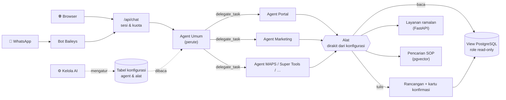

<div align="center">

# 👑 Ratu AI

**Portal AI assistant multi-departemen. Karyawan bertanya soal data departemennya lewat web dan WhatsApp, dan jawabannya diambil langsung dari database perusahaan.**


</div>

---

## Tentang proyek

Ratu AI adalah portal tempat karyawan bertanya ke AI dengan bahasa sehari-hari, misalnya:

> *"Tiket helpdesk saya yang belum selesai apa saja?"*
> *"Produk apa yang penjualannya turun bulan ini?"*
> *"Bagaimana prosedur pengajuan cuti?"*

AI tidak mengarang jawaban. Pertanyaan diteruskan ke **agent aplikasi** yang tepat (Portal, Marketing, MAPS, Super Tools, CMOD, dan lainnya), lalu agent itu membaca data lewat **alat** yang disaring sesuai hak akses penanya.

Agent dan alatnya **tidak ditulis mati di kode**. Keduanya dibaca dari tabel konfigurasi di database perusahaan dan diatur tim IT lewat layar **Kelola AI**, sehingga alat baru bisa ditambahkan tanpa mengubah kode.

## ✨ Fitur utama

| Fitur | Keterangan |
|---|---|
| 💬 **Tanya data per departemen** | Penjualan, stok, tiket IT, aset, karyawan, klaim & program MAPS, kunjungan outlet, order, dan lain-lain |
| 📱 **Web & WhatsApp** | Satu agent yang sama melayani portal web dan bot WhatsApp |
| 📝 **Isi data dengan konfirmasi** | AI menyusun *rancangan* (tiket, penjualan, lembur, pelamar). Data baru tersimpan setelah pengguna menekan **Simpan** |
| 📚 **Cari SOP / panduan** | Pencarian dokumen (RAG + pgvector), jawabannya menyebut sumber dan halaman |
| 📈 **Ramalan penjualan** | Model statistik yang dipilih lewat backtest (layanan Python terpisah), bukan tebakan model bahasa |
| 🌐 **Riset pasar** | Tren pasar dan berita industri dari internet, ditampilkan berdampingan dengan data internal |
| ⚙️ **Kelola AI** | Layar tim IT untuk menambah, mengubah, menyambungkan, dan menyetujui alat agent |
| 🔐 **Hak akses berlapis** | Agent, alat, dan cakupan data mengikuti aplikasi & peran pengguna di sistem perusahaan |
| 🛡️ **Penjaga alur** | Mencegah AI mengaku sudah menyimpan data, memilihkan untuk pengguna, atau menjawab "tidak ada data" ketika yang terjadi sebenarnya galat |

## 🏗️ Arsitektur



**Alur singkat**

1. Pengguna login dengan akun perusahaan. Aplikasi dan peran yang ia pegang menentukan agent dan alat yang terbuka.
2. **Perute** memilih agent aplikasi yang alatnya cocok dengan pertanyaan.
3. Agent memanggil alat. Alat **baca** menjalankan `SELECT` ke view khusus asisten, sudah disaring sesuai pemilik data. Alat **tulis** hanya menyusun rancangan.
4. **Penjaga alur** memeriksa setiap langkah sebelum jawaban sampai ke pengguna.

**Model yang didukung:** Claude (Anthropic), Qwen3 14B lewat gateway LiteLLM + vLLM, Gemma 12B, dan Qwen2.5 lokal (Ollama). Model dipilih pengguna dari daftar yang diizinkan.

## 📊 Hasil pengujian

Uji kapasitas 1–20 pengguna bersamaan dengan Qwen3 14B, sebelum dan sesudah perbaikan alur agent (Tahap 1–6, November 2026):

| Ukuran | Sebelum | Sesudah |
|---|---:|---:|
| Akurasi jawaban | 89,6% | **94,4%** |
| Jawaban gagal | 19 | **2** |
| Jawaban paling lambat (P99) di 20 pengguna | 167 detik | **100 detik** |

Rincian ada di [`docs/workflow-agent/`](docs/workflow-agent/) dan [`docs/benchmark/`](docs/benchmark/). Dashboard evaluasi lengkap ada di `docs/benchmark/grafik/ratu-ai-performance-evaluation.html`. Unduh berkasnya dan buka di browser (GitHub tidak menampilkan HTML).

## 🧰 Teknologi

| Lapisan | Yang dipakai |
|---|---|
| Web | Next.js 16 (App Router), React 19, Tailwind CSS 4 |
| Agent | VoltAgent 2.10, Vercel AI SDK 6, Zod |
| Data | PostgreSQL perusahaan (view asisten, pgvector), MySQL portal (pengguna, percakapan, kuota) |
| WhatsApp | Baileys 6.17 |
| Ramalan | Python, FastAPI |
| Model | Anthropic Claude, Qwen3 (vLLM + LiteLLM), Gemma, Ollama |

## 🚀 Menjalankan

**Prasyarat:** Node.js 24, MySQL (mis. Laragon), akses ke PostgreSQL perusahaan, dan Python 3 untuk layanan ramalan.

```bash
npm install
cp .env.example .env.local   # isi kredensial & kunci API di sini
npm run dev                  # http://localhost:3000
```

<details>
<summary><b>Perintah lain</b></summary>

| Perintah | Fungsi |
|---|---|
| `npm run dev` | Server pengembangan |
| `npm run deploy` | Cek tipe (`tsc --noEmit`), build, lalu jalankan di port 3018 |
| `npm run wa` | Bot WhatsApp (proses terpisah) |
| `npm run forecast` | Layanan ramalan Python (port 8100) |
| `npm run voltagent:run` | Server debug VoltOps (port 3141) |
| `npm run lint` | ESLint |

Skrip di `scripts/*.mts` dijalankan dengan `tsx --env-file=.env.local`.

</details>

<details>
<summary><b>Uji</b></summary>

Jalankan satu per satu:

```bash
npm run test:konfig        # pembacaan konfigurasi agent & alat
npm run test:tool-konfig   # perakitan alat + gerbang izin
npm run test:izin-tool     # izin per aplikasi, izin ganda, cakupan per peran
npm run test:agent-konfig  # agent & perute
npm run test:akses-app     # akses aplikasi per karyawan
npm run test:jalur         # jalur agent konfigurasi
npm run test:penjaga       # penjaga route
npm run test:alur-semua    # penjaga alur Tahap 1–6 (tanpa model)
npm run test:wa            # format pesan WhatsApp
```

Uji yang menyentuh database membutuhkan `.env.local` yang terisi. Uji yang menulis data sengaja dipisah dan tidak termasuk daftar di atas.

</details>

<details>
<summary><b>Pengaturan penting di <code>.env.local</code></b></summary>

| Variabel | Fungsi |
|---|---|
| `JALUR_AGENT=konfigurasi` | Memakai agent & alat dari database perusahaan |
| `IZIN_GANDA` | Arti koma pada syarat izin alat: `semua` (bawaan) atau `salah-satu` |
| `TINJAU_TOOL_BARU` | `nyala` (bawaan): alat baru tim lain ditahan sampai diputuskan di Kelola AI. `mati`: langsung dipakai |
| `ALAT_PORTAL` | `ganti` (bawaan), `tambah`, atau `tanpa`: cara alat buatan portal dipasang berdampingan dengan alat tim lain |
| `MAKS_TOOL_SERVER`, `MAKS_BARIS_SERVER` | Batas alat & baris hasil untuk model berkapasitas kecil |
| `PENJAGA_ALUR` | `mati` untuk mematikan penjaga alur (perbandingan A/B) |

Daftar lengkapnya ada di [`.env.example`](.env.example).

</details>

## 📁 Struktur folder

| Folder | Isi |
|---|---|
| [`app/`](app/) | Halaman (chat, login, Kelola AI) dan API route |
| [`voltagent/`](voltagent/) | Perute, agent aplikasi, perakit alat, daftar model |
| [`lib/`](lib/) | Akses database, izin, penulisan data, pencarian SOP, penjaga alur, kuota |
| [`wa-bot/`](wa-bot/) | Bot WhatsApp |
| [`forecast-service/`](forecast-service/) | Layanan ramalan penjualan (Python) |
| [`mr-gateway/`](mr-gateway/) | Dashboard MR AI Gateway (LiteLLM), proyek Next.js terpisah |
| [`scripts/`](scripts/) | Uji, benchmark, dan skrip administrasi |
| [`db/`](db/) | SQL penyiapan database (role, view, hak akses) |
| [`docs/`](docs/) | Logbook, benchmark, catatan fitur, panduan. Lihat [`docs/README.md`](docs/README.md) |

## 🔒 Prinsip keamanan

- **Database perusahaan dibaca lewat role read-only.** Penulisan memakai role terpisah dengan hak per kolom, dan selalu lewat konfirmasi pengguna.
- **Identitas penyaring datang dari sesi login, bukan dari AI.** Model tidak bisa diarahkan membaca data orang lain.
- **Alat yang bukan hak pengguna tidak dipasang sama sekali.** Bukan sekadar "dilarang" lewat kalimat di instruksi.
- **Kredensial hanya di `.env.local`.** Berkas itu tidak pernah masuk repositori.

## 📖 Dokumentasi

- [`docs/panduan/cara-menambah-tool.md`](docs/panduan/cara-menambah-tool.md): menambah alat dari layar Kelola AI
- [`docs/workflow-agent/`](docs/workflow-agent/): analisis kegagalan dan perbaikan alur agent
- [`docs/benchmark/`](docs/benchmark/): uji beban dan benchmark model
- [`docs/logbook/`](docs/logbook/): catatan kerja harian

---

<div align="center">

Dibuat oleh **Ridho Muhammad Dafi**<br/>
Proyek **MagangHub** di **PT Mustika Ratu**

<sub>© 2026 Ridho Muhammad Dafi. Hak cipta dilindungi. Kode ini tidak dilisensikan untuk dipakai ulang tanpa izin.</sub>

</div>
