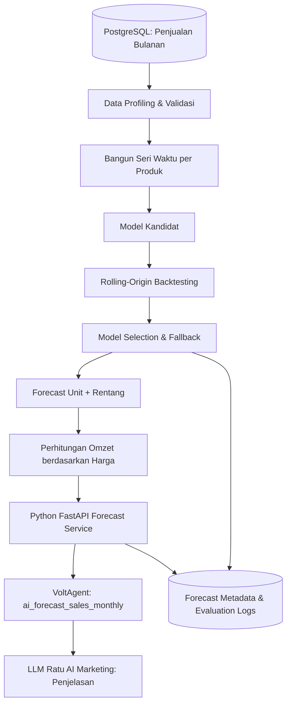

# Temuan dan Rekomendasi Pengembangan Sales Forecasting — Ratu AI Marketing

**Tanggal:** 3 November 2026  
**Status:** Hasil analisis awal dan usulan implementasi; belum merupakan hasil pengujian model baru  
**Ruang lingkup:** Forecasting penjualan produk per bulan (*monthly*) menggunakan PostgreSQL, Python forecasting service, dan VoltAgent.

## 1. Latar Belakang

Ratu AI Marketing sudah memiliki tool `ai_forecast_sales_monthly` untuk menjawab pertanyaan proyeksi penjualan produk. Dari contoh hasil untuk produk **MINYAK CEMCEMAN 75 ML** (kode **1005997**), sistem masih memilih model **Naive** dengan prediksi yang identik pada seluruh bulan target.

Bentuk data penjualan yang digunakan adalah **rekap bulanan (monthly)**. **Panjang histori per produk belum diketahui** dan harus dideteksi langsung dari database sebelum menentukan model serta strategi evaluasi.

**Tujuan pengembangan:** meningkatkan keandalan forecasting, menguji beberapa kandidat model secara objektif, memilih model terbaik per produk, dan menyampaikan batasan serta kualitas prediksi secara transparan melalui Ratu AI Marketing.

## 2. Temuan dari Output Saat Ini

### 2.1 Contoh forecast yang diamati

| Periode | Ramalan unit | Rentang unit | Ramalan omzet | Rentang omzet |
|---|---:|---:|---:|---:|
| Desember 2026 | 1.445 | 759–2.131 | Rp36.000.900 | Rp23.335.750–Rp48.666.050 |
| Januari 2027 | 1.445 | 759–2.131 | Rp36.000.900 | Rp23.335.750–Rp48.666.050 |
| Februari 2027 | 1.445 | 759–2.131 | Rp36.000.900 | Rp23.335.750–Rp48.666.050 |

- Metode tertera: **Naive (sama dengan bulan terakhir)**.
- WAPE unit yang dilaporkan: **19%**.
- WAPE rupiah yang dilaporkan: **16,4%**.
- Data penjualan aktual terakhir yang disebutkan: **Juli 2026**.
- Harga per unit yang disebutkan: sekitar **Rp24.914**.

> Nilai di atas adalah hasil sistem yang diamati, **bukan** perhitungan atau validasi baru. WAPE adalah galat relatif agregat dari evaluasi historis, **bukan** jaminan akurasi masa depan; hindari menyebut `100% - WAPE` sebagai probabilitas atau tingkat kepastian prediksi.

### 2.2 Masalah / risiko yang ditemukan

| ID | Temuan | Dampak | Prioritas |
|---|---|---|---|
| F-01 | Prediksi tiga bulan identik karena memakai Naive. | Belum menangkap tren dan musiman secara eksplisit. | Tinggi |
| F-02 | Data terakhir Juli 2026 untuk target Desember 2026–Februari 2027. | Target berada pada horizon **5, 6, dan 7 bulan** dari observasi terakhir, bukan 1, 2, dan 3 bulan. | Kritis |
| F-03 | Panjang histori data belum diketahui. | Kelayakan model musiman dan validitas backtesting belum dapat dipastikan. | Kritis |
| F-04 | WAPE tersedia tetapi detail skema pengujian tidak diketahui. | Performa yang dilaporkan belum bisa dinilai sebagai performa pada horizon 5–7 bulan. | Tinggi |
| F-05 | Rentang unit dan rentang omzet tidak langsung konsisten dengan perkalian rentang unit × Rp24.914. | Perlu klarifikasi: omzet diprediksi independen atau diturunkan dari unit? Risiko interpretasi yang keliru. | Tinggi |
| F-06 | Nilai ramalan rupiah juga memiliki sedikit selisih dengan 1.445 × Rp24.914. | Perlu cek harga presisi, pembulatan, dan sumber perhitungan. | Sedang |
| F-07 | Tingkat cakupan dan metode pembentukan rentang 'paling rendah/tinggi' tidak dijelaskan. | Pengguna dapat salah mengira rentang sebagai interval kepercayaan terkalibrasi. | Tinggi |
| F-08 | Belum terkonfirmasi penanganan bulan kosong, penjualan nol, dan kehabisan stok. | Seri waktu dapat terdistorsi dan pemilihan model menjadi bias. | Tinggi |

**Catatan:** F-05 dan F-06 adalah **hal yang harus diverifikasi pada implementasi**, bukan kepastian adanya bug. Rentang omzet dapat berbeda jika memang dimodelkan secara terpisah; sistem hanya perlu menjelaskan metodologinya dengan jelas.

## 3. Keputusan Desain yang Direkomendasikan

1. Pertahankan **PostgreSQL** sebagai sumber data utama.
2. Tambahkan **Python Forecasting Service (FastAPI)** sebagai mesin perhitungan.
3. Tetap gunakan **VoltAgent** untuk *tool calling* dan **LLM** untuk penjelasan, bukan untuk menghasilkan angka prediksi tanpa perhitungan yang teruji.
4. Terapkan **automatic model selection per produk**, berdasarkan data yang tersedia dan performa backtesting yang sesuai horizon.
5. Gunakan **Naive/Seasonal Naive sebagai baseline**; model kompleks hanya dipilih bila terbukti lebih baik.
6. Buat **forecast unit** sebagai target utama. Hitung omzet memakai asumsi harga per periode yang didefinisikan secara eksplisit; jika omzet juga dimodelkan secara terpisah, tandai metodologinya.
7. Simpan *metadata* kualitas data, model terpilih, waktu data terakhir, horizon, versi model, serta hasil evaluasi untuk audit.

## 4. Arsitektur Target



**Peran komponen:**
- **PostgreSQL:** menyimpan data historis dan metadata hasil forecast.
- **Python/FastAPI:** menyiapkan seri waktu, menjalankan model, backtesting, dan menyajikan hasil via API internal.
- **VoltAgent:** merutekan permintaan forecast dari pengguna ke API dan meneruskan respons terstruktur.
- **LLM:** mengubah hasil numerik menjadi penjelasan bisnis, peringatan, serta interpretasi yang konsisten dengan output API.

## 5. Strategi Kandidat Model

Gunakan tabel berikut sebagai **heuristik awal**, bukan aturan mutlak:

| Panjang histori per produk | Kandidat yang layak diuji | Catatan |
|---|---|---|
| 1–5 bulan | Naive, rata-rata historis | Data terlalu pendek untuk evaluasi yang kuat; keluarkan peringatan. |
| 6–11 bulan | Naive, Simple Exponential Smoothing (SES), Holt | Evaluasi tren sederhana; jangan memaksakan musiman tahunan. |
| 12–23 bulan | Naive, SES/Holt, AutoETS, AutoARIMA nonmusiman | Musiman 12-bulanan belum cukup teruji. |
| 24–35 bulan | Semua baseline yang relevan, Seasonal Naive, AutoETS/AutoARIMA musiman | Periksa jumlah siklus dan hasil backtesting sebelum menggunakan seasonal. |
| 36+ bulan | Kandidat statistik + LightGBM melalui MLForecast bila data memungkinkan | Model ML harus mengungguli baseline out-of-sample. |

Tambahan:
- **Croston/TSB** untuk *intermittent demand* (banyak bulan bernilai nol).
- **SARIMAX, model regresi atau LightGBM** untuk fitur harga, stok, promosi, dan kalender jika data historis fitur memadai serta **fitur masa depan diketahui/diestimasi dengan benar**.
- **Prophet** opsional, bukan prioritas awal.
- **LSTM/Transformer** bukan pilihan pertama untuk seri bulanan pendek.

**Library awal:** `statsforecast`, `utilsforecast`, `pandas`/`polars`, `fastapi`, `pydantic`; opsional kemudian `mlforecast` + `lightgbm`.

## 6. Data Profiling Wajib Sebelum Modeling

Untuk setiap `product_id`, hitung:

- `first_actual_month`, `last_actual_month`, `history_months`.
- Jumlah bulan valid, bulan hilang, bulan dengan penjualan nol, dan duplikasi `(product_id, month)`.
- Konsistensi satuan, retur/penjualan negatif, perubahan SKU, dan anomali besar.
- Informasi *stockout* atau ketersediaan barang bila ada.
- Harga rata-rata serta perubahan harga dan promosi bila tersedia.
- Status kesegaran data (`fresh`, `stale`, atau indikator jarak bulan yang transparan).

**Penting:** Bulan tanpa transaksi yang benar-benar nol tidak boleh otomatis disamakan dengan bulan yang datanya belum masuk. Data bulan kosong perlu diselesaikan menurut sumber transaksi dan kalender bisnis yang benar.

### Skema minimum yang diharapkan

| Field | Tipe / contoh | Keterangan |
|---|---|---|
| `product_id` | string / `1005997` | Identitas produk |
| `month` | date / `2026-07-01` | Bulan observasi |
| `units_sold` | numeric / `1445` | Unit aktual |
| `revenue` | numeric / `36000900` | Omzet aktual |
| `avg_price` | numeric / `24914` | Opsional untuk analisis harga |
| `stockout_flag` | boolean / `false` | Opsional; memengaruhi permintaan teramati |
| `promo_flag` | boolean / `false` | Opsional; fitur model multivariat |

## 7. Backtesting dan Pemilihan Model

### 7.1 Metode

Gunakan **rolling-origin backtesting** / *time-series cross-validation*, bukan *random train-test split*.

1. Susun data per produk sesuai urutan waktu.
2. Tentukan horizon yang ingin didukung, misalnya `h=1–3`, dan bila prediksi diminta jauh dari data terakhir, uji juga horizon aktual seperti `h=5–7`.
3. Pada setiap *fold*, latih model hanya dengan data sebelum tanggal asal prediksi.
4. Buat prediksi ke periode uji, bandingkan dengan aktual, dan ulangi pada beberapa *fold*.
5. Nilai metrik **per horizon** dan agregat sesuai kebutuhan bisnis.
6. Pilih model yang mengungguli baseline dengan selisih bermakna; jika hasil sangat mirip, pilih yang lebih sederhana dan stabil.
7. Jika jumlah *fold* atau histori tidak cukup, kembalikan **baseline + peringatan**, bukan klaim model unggulan.

### 7.2 Metrik

| Metrik | Tujuan |
|---|---|
| **WAPE** | Kesalahan absolut total dibagi total aktual; tidak terdefinisi bila total aktual = 0. |
| **MAE** | Selisih absolut rata-rata dalam satuan unit. |
| **MASE** | Performa relatif terhadap baseline Naive pada data pelatihan; perhatikan kasus skala nol. |
| **Bias / Mean Error** | Mendeteksi model yang konsisten terlalu tinggi/rendah. |
| **Prediction Interval Coverage** | Memeriksa apakah rentang prediksi benar-benar mencakup aktual pada tingkat target. |

**Aturan evaluasi:** jangan menyamakan `WAPE 19%` dengan probabilitas ramalan benar sebesar `81%`. Dokumentasikan jendela uji, jumlah *fold*, horizon, jumlah produk, dan kondisi ketika metrik tidak dapat dihitung.

### 7.3 Pencegahan data leakage

- Rolling mean, lag, dan fitur penjualan hanya menggunakan data yang tersedia **sebelum periode prediksi**.
- Harga/promosi/kalender masa depan boleh digunakan hanya jika memang sudah terjadwal atau ada skenario eksplisit; jangan memakai informasi realisasi masa depan saat pengujian.
- Optimasi hiperparameter tidak boleh mengevaluasi berulang kali pada *holdout* akhir yang sama tanpa kontrol.

## 8. Aturan Forecast dan Transparansi Output

1. Deret waktu harus berlanjut dari **bulan aktual terakhir** sampai target akhir; misalnya data terakhir Juli 2026 berarti Desember 2026 adalah horizon ke-5.
2. Kembalikan `last_actual_month`, `forecast_generated_at`, dan `forecast_horizon` dalam respons API.
3. Sertakan `selected_model`, alasan pemilihan, metode evaluasi, dan peringatan kualitas data.
4. Jangan memberi rentang 'terendah/tertinggi' tanpa menyebutkan cara menghitung dan target *coverage*-nya; gunakan kalibrasi/backtesting jika ingin interval probabilistik.
5. Tunjukkan `price_assumption` dan metode estimasi omzet. Selaraskan unit, omzet, serta pembulatan.
6. Bedakan **omzet** dengan **laba**; laba membutuhkan data biaya.
7. Bila tidak cukup bukti untuk menyatakan model lebih baik, beri label **baseline forecast** atau **low confidence** sebagai kualitas analitik, bukan kepastian numerik yang dibuat-buat.

### Contoh kontrak respons API (ilustratif)

```json
{
  "product_id": "1005997",
  "granularity": "monthly",
  "last_actual_month": "2026-07",
  "requested_months": ["2026-12", "2027-01", "2027-02"],
  "selected_model": "naive",
  "selection_status": "baseline_only",
  "model_evaluation": {
    "wape": 0.19,
    "evaluated_horizons": [],
    "backtest_folds": null
  },
  "price_assumption": {
    "method": "last_known_price",
    "amount_idr": 24914
  },
  "forecasts": [
    {
      "month": "2026-12",
      "horizon_from_last_actual": 5,
      "forecast_units": 1445,
      "forecast_revenue_idr": 36000730,
      "interval": null
    }
  ],
  "warnings": [
    "Tanggal data aktual terakhir sudah beberapa bulan sebelum periode target.",
    "Evaluasi horizon 5–7 bulan belum diverifikasi.",
    "Contoh omzet dihitung dari 1445 x 24914; mungkin berbeda dari output lama karena pembulatan atau sumber harga."
  ]
}
```

> JSON di atas adalah **contoh rancangan struktur**, bukan data hasil pengujian baru. Angka omzet contoh berasal dari perkalian eksplisit `1.445 × 24.914 = 36.000.730`.

## 9. Rencana Implementasi Bertahap

### Fase 1 — Audit data dan hasil lama (prioritas tertinggi)

- [ ] Periksa query sumber data PostgreSQL per produk.
- [ ] Catat jumlah histori, bulan hilang, nilai nol, dan kesegaran data.
- [ ] Verifikasi definisi WAPE dan skema pengujian saat ini.
- [ ] Audit kalkulasi rupiah, rentang prediksi, harga, dan pembulatan.
- [ ] Pastikan horizon dihitung dari bulan aktual terakhir.

**Output:** laporan kualitas data dan baseline yang dapat direproduksi.

### Fase 2 — Statistical forecasting engine

- [ ] Implementasikan Naive, Seasonal Naive, SES, Holt, AutoETS, AutoARIMA (sesuai kelayakan histori).
- [ ] Tambahkan Croston/TSB bila ditemukan produk *intermittent*.
- [ ] Gunakan mekanisme fallback untuk histori pendek atau kualitas data buruk.
- [ ] Pisahkan forecast unit, asumsi harga, dan perhitungan omzet.

**Output:** fungsi forecasting deterministik per produk.

### Fase 3 — Backtesting & automatic model selection

- [ ] Terapkan rolling-origin backtesting untuk horizon yang digunakan.
- [ ] Hitung WAPE, MAE, MASE, bias, serta coverage bila tersedia interval.
- [ ] Simpan metrik, model terpilih, jumlah *fold*, periode uji, dan versi model.
- [ ] Terapkan kebijakan memilih model yang sederhana jika kandidat setara.

**Output:** pemilihan model terukur, bukan berdasarkan asumsi.

### Fase 4 — Integrasi VoltAgent

- [ ] Sediakan endpoint FastAPI internal untuk forecast dan evaluasi.
- [ ] Integrasikan dengan tool `ai_forecast_sales_monthly`.
- [ ] Buat format respons LLM yang membedakan fakta, prediksi, rentang, dan peringatan.
- [ ] Pastikan LLM tidak mengubah angka API saat merangkumnya.

**Output:** pengguna Ratu AI Marketing memperoleh forecast dan penjelasan yang bisa diaudit.

### Fase 5 — ML dan sinyal bisnis (setelah fondasi stabil)

- [ ] Evaluasi MLForecast + LightGBM untuk data yang memadai.
- [ ] Tambahkan fitur harga, stok, kalender, promosi, dan musiman.
- [ ] Integrasikan sinyal market trends/web search sebagai **fitur pendukung**, bukan pengganti data aktual.
- [ ] Bandingkan kinerja ML dengan baseline statistik memakai backtesting yang sama.

**Output:** model lanjutan hanya diaktifkan jika memberi peningkatan tervalidasi.

## 10. Kriteria Penerimaan (Acceptance Criteria)

- [ ] Sistem dapat mengidentifikasi histori dan kualitas data **setiap produk** secara otomatis.
- [ ] Tidak ada pembacaan data masa depan yang bocor ke pelatihan/evaluasi.
- [ ] Forecast menampilkan horizon aktual dari `last_actual_month`.
- [ ] Setiap hasil memiliki nama model, alasan pemilihan/fallback, dan metadata evaluasi bila tersedia.
- [ ] WAPE dan metrik lain diuji dengan fungsi yang terdokumentasi; kondisi pembagi nol ditangani.
- [ ] Omzet konsisten dengan metode yang dinyatakan dan pembulatan terdokumentasi.
- [ ] Interval prediksi memiliki metode serta target coverage yang jelas, atau tidak ditampilkan.
- [ ] Unit test meliputi histori pendek, data bolong, semua nol, penjualan negatif/retur, perubahan harga, dan horizon jauh.
- [ ] Model baru tidak dipromosikan sebagai lebih akurat tanpa bukti out-of-sample dibanding baseline.
- [ ] Respons VoltAgent/LLM tidak mengarang angka atau tingkat kepastian.

## 11. Daftar Pertanyaan Teknis untuk Audit Repository

1. Berapa minimum, median, dan maksimum jumlah bulan historis tiap SKU?
2. Apakah data tersedia per transaksi tetapi diaggregasi bulanan, atau sumber memang hanya rekap bulanan?
3. Apakah terdapat kolom stok, pengembalian barang, diskon, dan promosi?
4. Apakah `WAPE 19%` dihitung pada horizon yang sama dengan periode forecast yang diminta?
5. Apakah model Naive dipilih karena hasil backtesting terbaik atau karena satu-satunya implementasi yang ada?
6. Bagaimana perhitungan batas rendah/tinggi serta interval rupiah pada versi sekarang?
7. Apakah harga rupiah menggunakan harga rata-rata, harga terakhir, harga katalog, atau harga bersih setelah diskon?
8. Apakah Agustus–Oktober 2026 sudah tersedia di database tetapi tidak terbaca oleh query?
9. Apakah proses retraining/forecast dijalankan saat permintaan atau melalui job terjadwal?

## 12. Arahan Pelaksanaan untuk Claude Code

> Audit implementasi `ai_forecast_sales_monthly` yang ada terlebih dahulu. Jangan langsung mengganti model, mengubah kontrak tool, atau melakukan migrasi skema database tanpa memeriksa dependensi. Mulai dengan mengidentifikasi sumber data, logika forecast, evaluasi, dan perhitungan omzet/rentang. Setelah itu implementasikan perbaikan secara bertahap mengikuti Fase 1–4, pertahankan kompatibilitas VoltAgent, tambahkan unit test/backtesting, dan dokumentasikan setiap perubahan. Fase 5 hanya dilanjutkan setelah hasil baseline dan validasi data memenuhi kriteria penerimaan.

---

**Kesimpulan:** masalah utamanya bukan sekadar penggunaan Naive, tetapi kombinasi **ketidakjelasan panjang histori**, **jarak data terakhir ke periode target**, **keterbatasan validasi WAPE**, dan **kurangnya transparansi konstruksi omzet serta interval**. Fokus pertama adalah audit data + backtesting yang benar, lalu *automatic model selection* dengan fallback yang aman.
